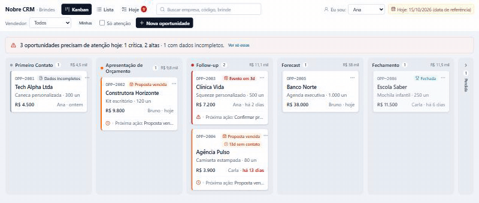
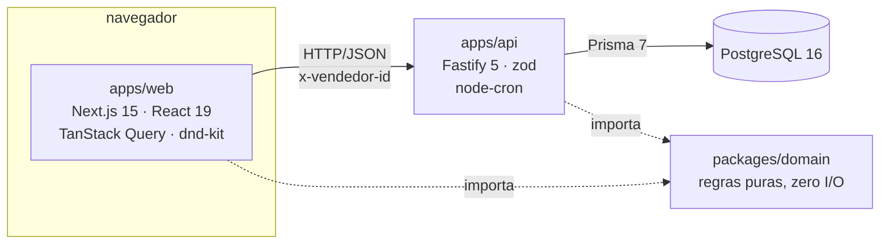
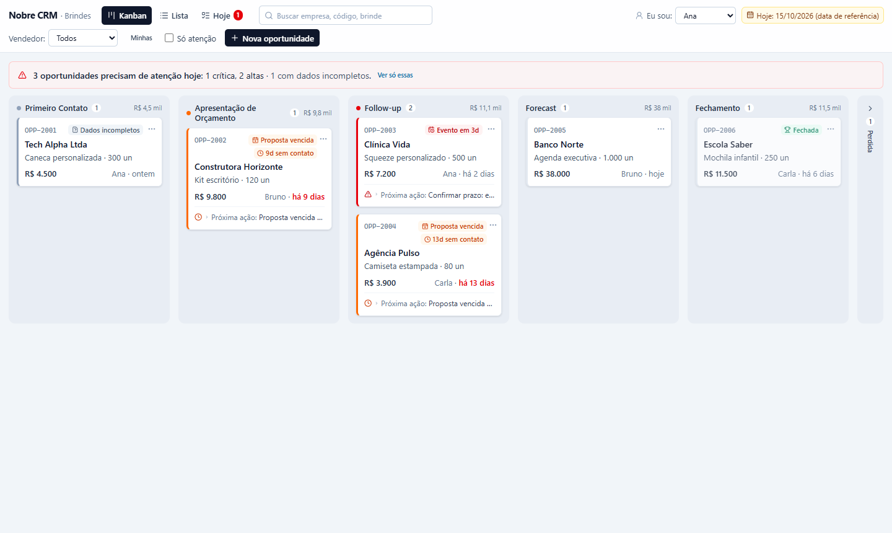
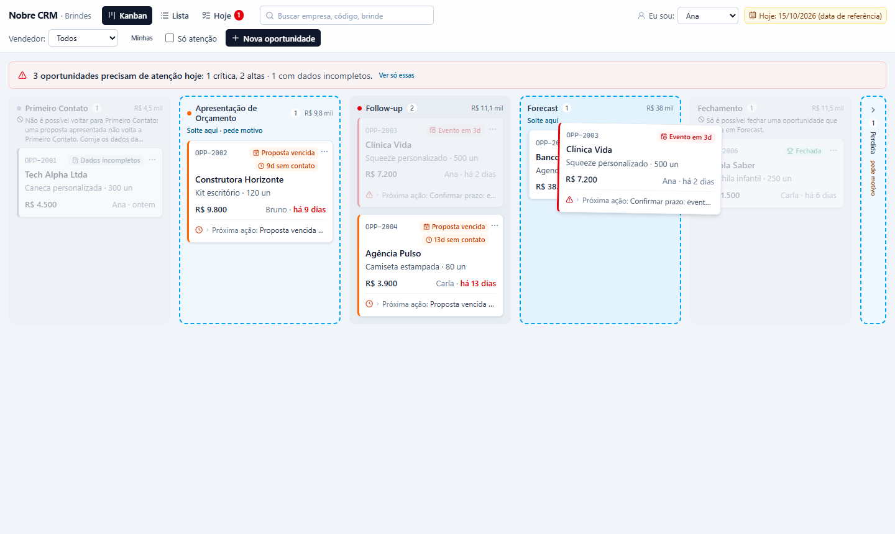
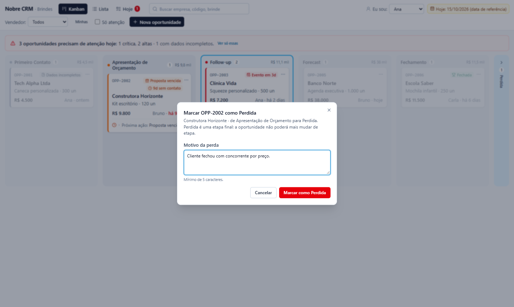
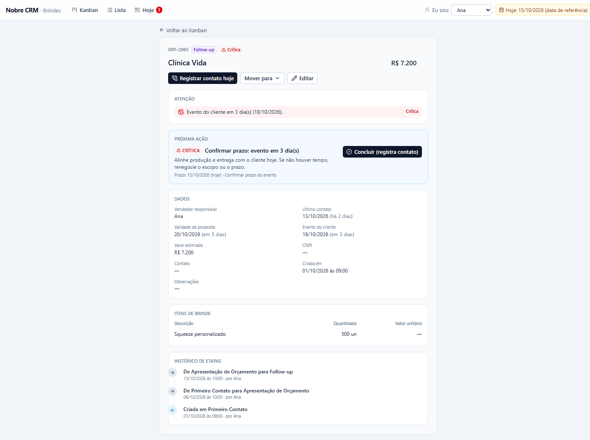
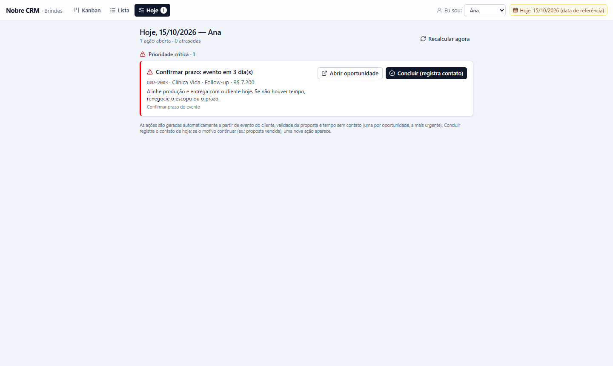
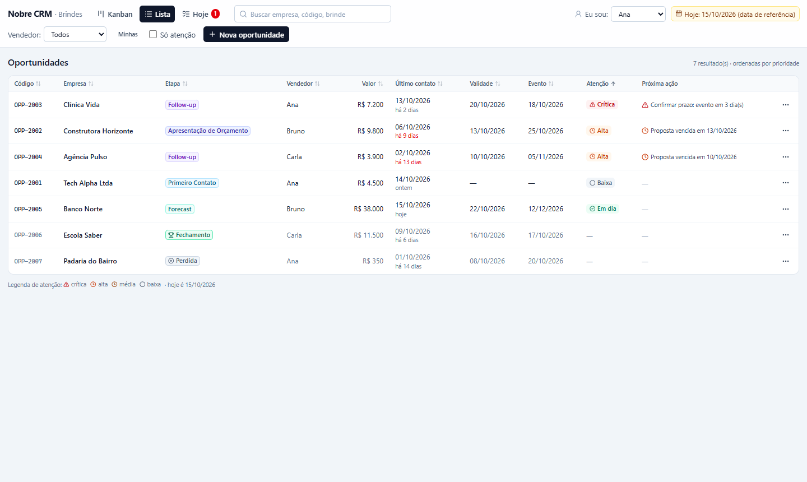
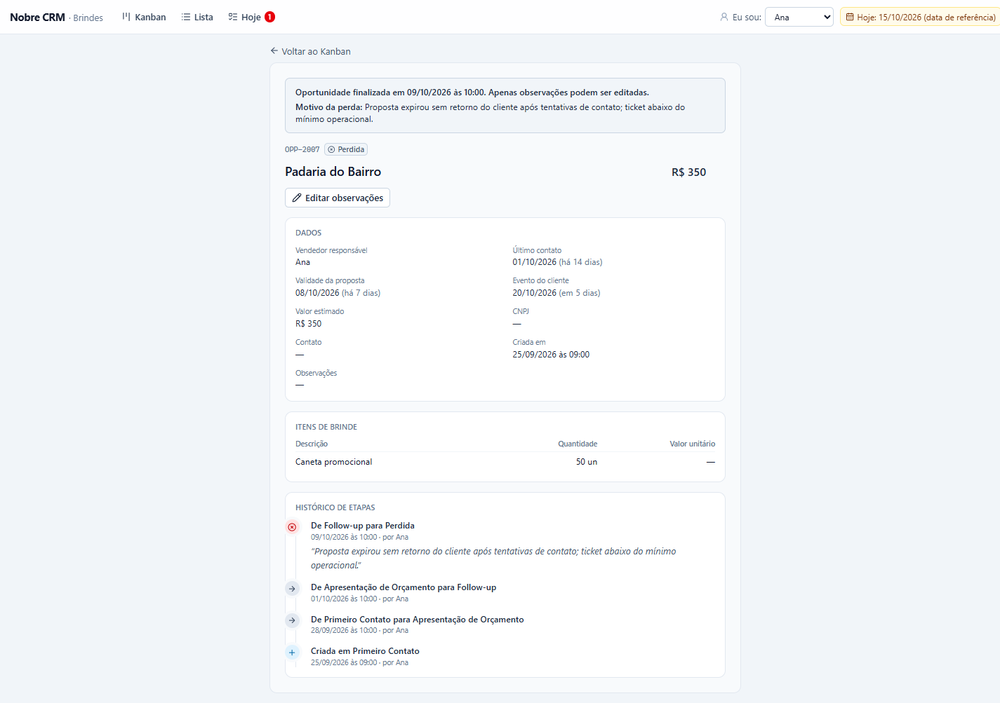

# Nobre CRM — funil comercial da Nobre Brindes

CRM interno para o time comercial da Nobre Brindes acompanhar oportunidades B2B pelo funil e responder, ao abrir a tela, à pergunta **"o que eu trabalho hoje?"**: quais negociações precisam de atenção antes que a venda seja perdida, em que ordem e qual é a próxima ação de cada uma.



*OPP-2004 (proposta vencida) sendo arrastada pelo teclado: só Apresentação de Orçamento (retorno, pede motivo) e Perdida aceitam; Forecast, Fechamento e Primeiro Contato ficam apagadas com o motivo do domínio no cabeçalho.*

## Índice

1. [Rodando em 2 minutos](#1-rodando-em-2-minutos)
2. [Rodando os testes](#2-rodando-os-testes)
3. [O que foi entregue](#3-o-que-foi-entregue)
4. [Arquitetura](#4-arquitetura)
5. [Regras do funil](#5-regras-do-funil)
6. [Sinais de atenção e priorização](#6-sinais-de-atenção-e-priorização)
7. [UX: como o vendedor encontra o que trabalhar hoje](#7-ux-como-o-vendedor-encontra-o-que-trabalhar-hoje)
8. [Automação: organização do follow-up (problema 4)](#8-automação-organização-do-follow-up-problema-4)
9. [Os outros três problemas: como eu resolveria](#9-os-outros-três-problemas-como-eu-resolveria)
10. [Segurança](#10-segurança)
11. [Dados fictícios e campos em branco](#11-dados-fictícios-e-campos-em-branco)
12. [Decisões e trade-offs](#12-decisões-e-trade-offs)
13. [Limitações e próximos passos](#13-limitações-e-próximos-passos)
14. [Uso de IA](#14-uso-de-ia)
15. [Autor](#15-autor)

---

## 1. Rodando em 2 minutos

Pré-requisito: Docker com Docker Compose.

```bash
git clone <url-do-repositório> nobre-crm && cd nobre-crm
cp .env.example .env
docker compose up --build
# Web:  http://localhost:3000
# API:  http://localhost:3333/health
```

O `up` sobe três serviços: **postgres** (PostgreSQL 16), **api** (Fastify) e **web** (Next.js). Ao iniciar, a API aplica as migrations, executa o seed (3 vendedores, as 7 oportunidades do case, 7 itens e 22 transições de histórico) e, dois segundos depois de começar a escutar, roda o job de follow-up, que cria as 3 ações do dia. No log da API aparece:

```
Seed concluído: 3 vendedores, 7 oportunidades, 7 itens, 22 transições.
... "origem":"boot","hoje":"2026-10-15","criados":3,"resolvidos":0,"substituidos":0,"mantidos":0,"msg":"job de follow-up: recálculo concluído"
```

O seed é idempotente: subir de novo não duplica nada. Para zerar tudo: `docker compose down -v`.

> **Atenção na demonstração:** reiniciar a API (`docker compose restart api` ou um novo `up`) **restaura as 7 oportunidades do case** ao estado original, desfazendo o que foi feito nelas pela interface. As oportunidades criadas pela interface (OPP-2008 em diante) são preservadas, assim como o histórico de follow-ups já encerrados (só as ações abertas são recriadas).

| Serviço | URL / porta | Observação |
|---|---|---|
| Web | http://localhost:3000 | Kanban (`/`), Lista (`/oportunidades`), detalhe (`/oportunidades/OPP-2003`), painel Hoje (`/hoje`) |
| API | http://localhost:3333 | `GET /health`, `GET /oportunidades`, ... (seção 5.6) |
| PostgreSQL | localhost:5432 | usuário/senha `nobre`/`nobre` (locais e descartáveis), banco `nobre_crm` |

### Data de referência (`REFERENCE_DATE`)

Os dados do case são de **15/10/2026**. Sinais de atenção e ações de follow-up dependem de "hoje"; usando a data real, em qualquer dia posterior tudo apareceria vencido e a demonstração perderia o sentido. Por isso o `.env.example` traz `REFERENCE_DATE=2026-10-15`: a API usa essa data como "hoje" em todo cálculo de domínio, e a interface mostra **"Hoje: 15/10/2026 (data de referência)"** no topo para ninguém se confundir.

Para usar a data real, remova a linha do `.env` (ou rode `REFERENCE_DATE= docker compose up`): `/health` passa a responder `referenciaFixa: false` e o indicador mostra só a data. Timestamps técnicos (quando uma transição aconteceu, quando uma ação foi encerrada) sempre usam o relógio real.

### "Eu sou": identidade sem login

Não há login (fora do escopo; ver seção 10). No topo da interface, o seletor **Eu sou** simula o usuário logado: o vendedor escolhido fica no `localStorage` e vai no header `x-vendedor-id` de toda escrita. É ele que aparece como autor no histórico de etapas e que define de quem é o painel Hoje. Na API, pegue os ids com `GET /vendedores`:

```bash
curl http://localhost:3333/vendedores
curl -X POST http://localhost:3333/oportunidades/OPP-2005/transicoes \
  -H "content-type: application/json" -H "x-vendedor-id: <id-do-bruno>" -d '{"para":"FECHAMENTO"}'
```

### Sem Docker para a aplicação

Só o banco no Docker; API e web rodando localmente (Node 24, a versão do `.nvmrc`, das imagens Docker e do CI; mínimo 20; pnpm 11):

```bash
docker compose up -d postgres
pnpm install
cp apps/api/.env.example apps/api/.env
cp apps/web/.env.example apps/web/.env
pnpm db:migrate        # prisma migrate dev: aplica as migrations no banco nobre_crm
pnpm db:seed
pnpm dev               # API em :3333 (com o job) e web em :3000
```

`pnpm db:migrate` é o `prisma migrate dev`, comando de desenvolvimento: além de aplicar as migrations, ele gera uma nova se o `schema.prisma` tiver mudado e pode pedir para recriar o banco se detectar divergência. Para só aplicar as existentes (como faz o container da API), use `pnpm --filter api exec prisma migrate deploy`.

### Variáveis de ambiente

| Variável | Padrão | Para quê |
|---|---|---|
| `DATABASE_URL` | (obrigatória) | conexão com o PostgreSQL; no compose é montada a partir de `POSTGRES_*` |
| `PORT` / `HOST` | `3333` / `0.0.0.0` | onde a API escuta |
| `CORS_ORIGIN` | `http://localhost:3000` | única origem aceita pelo CORS |
| `REFERENCE_DATE` | vazia (data real) | "hoje" dos cálculos de domínio, `YYYY-MM-DD` (ver acima) |
| `FOLLOWUP_CRON` | `0 * * * *` | frequência do job de follow-up (expressão cron) |
| `FOLLOWUP_WEBHOOK_URL` | vazia (desligado) | URL que recebe o resumo quando o job cria ações (seção 8) |
| `RATE_LIMIT_MAX` | `300` | requisições por minuto por IP antes do `429` |
| `LOG_LEVEL` | `info` | nível do log (`fatal` … `trace`, `silent`) |
| `NEXT_PUBLIC_API_URL` | `http://localhost:3333` | URL da API vista pelo navegador (embutida no build da web) |

A API valida todas no boot e, se alguma estiver inválida, para com uma mensagem dizendo qual.

---

## 2. Rodando os testes

```bash
docker compose up -d postgres
pnpm install
pnpm test
```

`pnpm test` roda o Vitest nos três pacotes. Os testes da API rodam **em sequência** (um arquivo por vez, porque compartilham o banco e cada caso o reinicia com o seed), então essa parte leva cerca de 20 s; domínio e web levam poucos segundos. Os testes de integração da API usam um banco separado, `nobre_crm_test`, **criado automaticamente** no mesmo Postgres pelo `globalSetup` (que também aplica as migrations e se recusa a rodar contra qualquer banco cujo nome não termine em `_test`). A API é exercitada com `app.inject()` do Fastify, sem abrir porta, contra o Postgres real.

| Pacote | O que testa | Testes |
|---|---|---|
| `packages/domain` | máquina de estados (D-01…D-35), sinais e score (A-01…A-21), motor de próxima ação (F-01…F-14), datas civis (T-01…T-04). Inclui o seed de 15/10/2026 produzindo exatamente a tabela esperada | 80 |
| `apps/api` | coerência do seed com as regras; rotas, filtros, validação, erros, transições, histórico, atomicidade (I-01…I-31, I-40, I-41); follow-ups (I-32…I-39), resolução na transição, job no boot e webhook | 64 |
| `apps/web` | resumo de atenção, badges, estados vazio × sem resultados, leitura de valores | 6 |

Saída de referência (resumida):

```
packages/domain test:       Tests  80 passed (80)
apps/api test:       Tests  64 passed (64)
apps/web test:       Tests  6 passed (6)
```

Os IDs dos casos (`D-03`, `I-22`, `F-13`…) estão no texto dos `it(...)`, para localizar rápido a regra testada. Cobertura do domínio: `pnpm --filter domain test:coverage` (≈98% das linhas). `pnpm lint` e `pnpm typecheck` rodam em todos os pacotes; há um workflow de CI em `.github/workflows/ci.yml` que executa `pnpm audit --audit-level high`, lint, typecheck, testes (com serviço Postgres) e build.

---

## 3. O que foi entregue

| Pilar | O que existe | Onde |
|---|---|---|
| **Produto & UX** | Kanban com 6 colunas e drag & drop validado, ordenado por prioridade; resumo "o que precisa de atenção hoje"; busca e filtros na URL; lista em tabela; detalhe com timeline do histórico; formulário de criação/edição; painel Hoje; estados de carregando, erro, vazio e sem resultados | [`apps/web`](apps/web) |
| **Engenharia** | API REST (Fastify + Prisma + PostgreSQL); todas as regras do funil num pacote de domínio puro, validadas no backend; histórico de transições na mesma transação; erros padronizados; seed determinístico e coerente com as regras | [`packages/domain`](packages/domain), [`apps/api`](apps/api) |
| **Automação & Qualidade** | Motor de follow-up (uma próxima ação por oportunidade), recálculo idempotente após cada alteração, no boot e por cron, webhook opcional, painel Hoje; 150 testes | [`packages/domain/src/follow-up.ts`](packages/domain/src/follow-up.ts), [`apps/api/src/modules/follow-ups`](apps/api/src/modules/follow-ups) |

---

## 4. Arquitetura



Monorepo **pnpm workspaces** com três pacotes:

- **Por que monorepo:** o domínio é compartilhado pela API e pela web sem publicar pacote; um `pnpm test` testa tudo; um commit muda regra, API e tela juntos.
- **Por que um domínio puro separado:** as regras (transições, sinais, próxima ação) são o coração do case. Sem I/O e sem relógio (o "hoje" é parâmetro), elas são testadas isoladamente, de forma determinística, e a mesma função roda no servidor (fonte da verdade) e no navegador (só para explicar, durante o arrasto, por que uma coluna está bloqueada).
- **Fastify:** rápido, plugins oficiais (CORS, Helmet, rate limit), `inject()` para testar sem porta e validação/serialização por schema (zod via `fastify-type-provider-zod`).
- **Prisma:** schema declarativo, migrations versionadas, consultas parametrizadas e tipadas.
- **dnd-kit:** acessível (teclado e leitor de tela), sem depender de HTML5 drag & drop, funciona com React 19.
- **TanStack Query:** cache, estados de carregando/erro, invalidação e atualização otimista com rollback.

Estrutura resumida:

```
apps/
  api/
    prisma/            schema, migrations, seed-data.ts (dados do case) e seed idempotente
    src/
      app.ts           buildApp(): plugins e rotas (usado pelo server e pelos testes)
      server.ts        lê o env, sobe a API e agenda o job
      config/env.ts    validação das variáveis de ambiente (falha no boot com mensagem clara)
      lib/             relógio (REFERENCE_DATE), erros, conversão de datas, Prisma
      plugins/         identidade (x-vendedor-id) e tratamento de erros
      modules/         etapas, vendedores, oportunidades, transicoes, follow-ups
    test/              integração com Postgres real
  web/
    src/app/           rotas: / (Kanban), /oportunidades, /oportunidades/[id], /hoje
    src/components/    kanban, oportunidade, atencao, follow-ups, estados, layout, ui
    src/hooks/         consultas e mutações (TanStack Query)
    src/lib/           cliente HTTP, tipos dos DTOs, formatadores, identidade
packages/
  domain/src/          etapas, maquina-de-estados, atencao, follow-up, datas, erros
```

### Fluxo de uma transição

```
POST /oportunidades/:id/transicoes  { "para": "FORECAST" }
  → plugin identidade: x-vendedor-id → request.vendedor (401 se ausente ou inválido)
  → zod valida o corpo (400 VALIDACAO)
  → TransicoesService
      → carrega a oportunidade com os itens (404 se não existe)
      → domain.validarTransicao(op, para, motivo, hoje)  → 422 com o código do domínio se inválida
      → transação: UPDATE da etapa (só se ainda for a etapa validada) + INSERT no histórico
      → após o commit: recalcula a próxima ação (follow-up) da oportunidade
  → 200 com a oportunidade detalhada (sinais, transições permitidas, histórico)
```

A web nunca decide sozinha: ao arrastar, ela usa `transicoesPermitidas` (calculadas pelo servidor para aquela oportunidade) para habilitar colunas e a função do domínio para explicar as bloqueadas; ao soltar, envia o POST e mostra o que o servidor responder.

### Convenção de idioma

Vocabulário de domínio em **português** (`Oportunidade`, `validadeProposta`, `validarTransicao`, `proximaAcao`, rotas `/oportunidades`), porque é a língua do time comercial e do problema; infraestrutura técnica em **inglês** (`routes`, `service`, `repository`, `buildApp`, `useQuery`), porque é a língua das ferramentas. Enums em `SNAKE_CASE` sem acento; textos de interface e mensagens de erro em português.

---

## 5. Regras do funil

### 5.1 Etapas

**Primeiro Contato → Apresentação de Orçamento → Follow-up → Forecast → Fechamento**, mais **Perdida**, aplicável a partir de qualquer etapa não final. **Fechamento** e **Perdida** são finais.

### 5.2 Matriz de transições

✅ permitida · ⚠️ permitida com pré-condição ou motivo · ❌ bloqueada · — mesma etapa

| De \ Para | Primeiro Contato | Apresentação | Follow-up | Forecast | Fechamento | Perdida |
|---|---|---|---|---|---|---|
| **Primeiro Contato** | — | ⚠️ valor, item e validade | ❌ salto | ❌ salto | ❌ só de Forecast | ⚠️ motivo |
| **Apresentação** | ❌ retorno bloqueado | — | ✅ | ❌ salto | ❌ só de Forecast | ⚠️ motivo |
| **Follow-up** | ❌ retorno bloqueado | ⚠️ retorno com motivo | — | ⚠️ proposta válida | ❌ só de Forecast | ⚠️ motivo |
| **Forecast** | ❌ retorno bloqueado | ⚠️ retorno com motivo | ⚠️ retorno com motivo | — | ✅ | ⚠️ motivo |
| **Fechamento** | ❌ final | ❌ final | ❌ final | ❌ final | — | ❌ final |
| **Perdida** | ❌ final | ❌ final | ❌ final | ❌ final | ❌ final | — |

### 5.3 Regras e origem

| Regra | Descrição | Origem |
|---|---|---|
| R-FINAL | De Fechamento ou Perdida não sai nenhuma transição | enunciado |
| R-FECH | Só entra em Fechamento vindo de Forecast | enunciado |
| R-PERDA | Perdida a partir de qualquer etapa não final, **com motivo** (mínimo 5 caracteres) | enunciado |
| R-PRE-1 | Entrar em Apresentação de Orçamento exige valor estimado > 0 e ao menos um item com quantidade > 0 | enunciado |
| R-PRE-2 | Entrar em Apresentação de Orçamento exige **validade da proposta** | própria |
| R-PRE-3 | Entrar em Forecast exige proposta **não vencida** | própria |
| R-SALTO | Avanço só para a etapa imediatamente seguinte | própria |
| R-RET-1/2/3 | Retornos permitidos: Follow-up → Apresentação; Forecast → Follow-up; Forecast → Apresentação | própria |
| R-RET-4 | Nenhum retorno para Primeiro Contato | própria |
| R-RET-MOTIVO | Todo retorno exige motivo | própria |
| R-MESMA | Mover para a mesma etapa é inválido | própria |

As regras moram só em [`packages/domain/src/maquina-de-estados.ts`](packages/domain/src/maquina-de-estados.ts) e são avaliadas numa ordem fixa (mesma etapa → final → perda → retorno → avanço), o que define qual erro é devolvido. Quando o destino é Fechamento e a origem não é Forecast, a resposta é `FECHAMENTO_SO_DE_FORECAST` (e não "salto"), porque é a mensagem mais útil para o vendedor.

### 5.4 Retornos de etapa: a decisão

**Permitidos, sempre com motivo:**

- **Follow-up → Apresentação de Orçamento:** o cliente pediu revisão (quantidade, item, prazo). É o retorno mais comum de uma venda consultiva.
- **Forecast → Follow-up:** o cliente adiou a decisão; a oportunidade deixou de ser previsível e não deve inflar a previsão de receita.
- **Forecast → Apresentação de Orçamento:** revisão de escopo ou preço na reta final ("fecha se baixar 10%"), comum em B2B.

**Bloqueados:**

- **Qualquer retorno para Primeiro Contato.** Uma proposta apresentada não "desapresenta". Se o problema é dado errado, corrige-se o dado (edição), não a etapa. Isso também impede usar o retorno para "zerar" o tempo em funil.
- **Saídas de etapas finais.** Fechamento e Perdida são imutáveis: o histórico precisa ser honesto. Reabrir uma perdida seria criar uma nova oportunidade referenciando a anterior (campo `reabertaDeId`), declarado como próximo passo.

**Por que motivo obrigatório nos retornos:** transforma um "voltou" em informação gerencial (quantas propostas são revisadas, por quê, por qual vendedor) e fica gravado no histórico.

### 5.5 Regras próprias e por quê

- **Avanço só sequencial (R-SALTO).** O funil só é mensurável (conversão e tempo por etapa) se toda oportunidade percorre as etapas. Um "sim imediato" do cliente passa rápido por Follow-up: custa dois cliques e preserva a métrica.
- **Validade obrigatória para apresentar orçamento (R-PRE-2).** Não existe proposta comercial sem prazo de validade; sem ela o sistema não consegue avisar que a proposta venceu, um dos principais sinais de atenção. O próprio dado do case confirma: toda oportunidade a partir de Apresentação tem validade.
- **Forecast exige proposta válida (R-PRE-3).** Forecast é previsão de receita; prever receita sobre uma proposta expirada é otimismo. Se venceu, o caminho é voltar para Apresentação, revisar e seguir.

### 5.6 Códigos de erro e API

Toda resposta de erro tem o formato `{ code, message, details? }`. As violações de regra respondem **422** com o código do domínio:

| code | mensagem |
|---|---|
| `MESMA_ETAPA` | A oportunidade já está nesta etapa. |
| `ETAPA_FINAL` | Oportunidades em Fechamento ou Perdida não podem mudar de etapa. |
| `MOTIVO_PERDA_OBRIGATORIO` | Informe o motivo da perda para marcar a oportunidade como Perdida. |
| `MOTIVO_RETORNO_OBRIGATORIO` | Informe o motivo para retornar a oportunidade de etapa. |
| `RETORNO_NAO_PERMITIDO` | Não é possível voltar para Primeiro Contato: uma proposta apresentada não volta a Primeiro Contato. … |
| `SALTO_DE_ETAPA` | Avance uma etapa por vez: de Primeiro Contato a próxima etapa é Apresentação de Orçamento. |
| `FECHAMENTO_SO_DE_FORECAST` | Só é possível fechar uma oportunidade que esteja em Forecast. |
| `PRE_CONDICAO_NAO_ATENDIDA` | Para apresentar o orçamento, informe: validade da proposta. (`details.faltando`) |
| `PROPOSTA_VENCIDA` | A proposta venceu em 10/10/2026. Revise a proposta (volte para Apresentação de Orçamento) antes de colocar em Forecast. |

```json
// POST /oportunidades/OPP-2001/transicoes  {"para":"APRESENTACAO_ORCAMENTO"}  → 422
{
  "code": "PRE_CONDICAO_NAO_ATENDIDA",
  "message": "Para apresentar o orçamento, informe: validade da proposta.",
  "details": { "faltando": ["validadeProposta"] }
}
```

Demais códigos: `400 VALIDACAO` (corpo, query ou parâmetros inválidos, com `details.issues`), `401 IDENTIDADE_AUSENTE`/`IDENTIDADE_INVALIDA`, `404 OPORTUNIDADE_NAO_ENCONTRADA`/`FOLLOW_UP_NAO_ENCONTRADO`/`VENDEDOR_NAO_ENCONTRADO`/`ROTA_NAO_ENCONTRADA`/`REGISTRO_NAO_ENCONTRADO`, `409 OPORTUNIDADE_FINALIZADA`/`FOLLOW_UP_JA_ENCERRADO`/`OPORTUNIDADE_ALTERADA`/`REFERENCIA_INVALIDA` (`REGISTRO_NAO_ENCONTRADO`, `OPORTUNIDADE_ALTERADA` e `REFERENCIA_INVALIDA` só aparecem em corrida: algo mudou ou sumiu entre a leitura e a escrita), `429 MUITAS_REQUISICOES`, `500 ERRO_INTERNO` (sem stack; o detalhe fica no log, correlacionado pelo header `x-request-id`).

| Rota | O que faz |
|---|---|
| `GET /health` | status, `hoje`, `referenciaFixa`, versão |
| `GET /etapas` | etapas, rótulos e transições estruturais (matriz acima) |
| `GET /vendedores` | vendedores por nome |
| `GET /oportunidades` | lista com sinais e próxima ação. Query: `q` (código, empresa ou item), `etapa` (uma ou várias separadas por vírgula), `vendedorId`, `atencao=true`, `severidade=CRITICA\|ALTA\|MEDIA\|BAIXA` (mínima), `incluirFinais`, `ordem=prioridade\|valor\|ultimoContato\|codigo` |
| `GET /oportunidades/:id` | detalhe por uuid **ou** código (`OPP-2003`), com histórico e follow-ups |
| `GET /oportunidades/:id/historico` | só a timeline |
| `POST /oportunidades` | cria em Primeiro Contato (`OPP-{maior+1}`), com a linha "criada" no histórico |
| `PATCH /oportunidades/:id` | edita; `itens` substitui a lista; em etapa final só aceita `observacoes` |
| `POST /oportunidades/:id/contatos` | "registrei contato hoje" (com observação opcional) |
| `POST /oportunidades/:id/transicoes` | muda de etapa (`{ para, motivo? }`) |
| `GET /follow-ups` | ações do vendedor (header ou `?vendedorId=`), por prioridade |
| `POST /follow-ups/:id/concluir` | conclui (por padrão registra contato) e recalcula |
| `POST /follow-ups/recalcular` | roda o motor para todas as oportunidades (mesma função do job) |

```bash
curl "http://localhost:3333/oportunidades?atencao=true"
# fechar OPP-2003 direto de Follow-up → 422 FECHAMENTO_SO_DE_FORECAST
curl -X POST http://localhost:3333/oportunidades/OPP-2003/transicoes \
  -H "content-type: application/json" -H "x-vendedor-id: <id-da-ana>" -d '{"para":"FECHAMENTO"}'
# marcar perdida sem motivo → 422 MOTIVO_PERDA_OBRIGATORIO
curl -X POST http://localhost:3333/oportunidades/OPP-2002/transicoes \
  -H "content-type: application/json" -H "x-vendedor-id: <id-do-bruno>" -d '{"para":"PERDIDA"}'
```

### 5.7 Histórico

Cada mudança de etapa grava exatamente uma linha em `transicoes_etapa` — **quando** (`created_at`), **de onde** (`de_etapa`, nula na criação), **para onde** (`para_etapa`), **motivo** e **quem executou** (`vendedor_id`, que pode ser diferente do dono da oportunidade) — na mesma transação do `UPDATE` da etapa. Há teste que força uma falha depois do update e antes do insert e prova que a etapa não muda (I-30). Na interface, o detalhe mostra a timeline (mais recente em cima): "Criada em Primeiro Contato", "De Follow-up para Apresentação de Orçamento (retorno)", com data/hora, autor e o motivo entre aspas.

---

## 6. Sinais de atenção e priorização

Calculados só para etapas não finais, sempre em relação ao "hoje" (data de referência):




| Sinal | Condição | Severidade | Peso |
|---|---|---|---|
| `EVENTO_PASSOU` | evento do cliente já passou | Crítica | 120 |
| `EVENTO_PROXIMO` | evento em 0–3 dias | Crítica | 100 |
| `EVENTO_PROXIMO` | evento em 4–7 dias | Alta | 60 |
| `PROPOSTA_VENCIDA` | validade < hoje (Apresentação, Follow-up, Forecast) | Alta | 50 |
| `PROPOSTA_VENCE_EM_BREVE` | validade em 0–3 dias | Média | 30 |
| `SEM_CONTATO` (lead) | Primeiro Contato sem contato há ≥ 2 dias (SLA) | Alta | 45 |
| `SEM_CONTATO` | demais etapas sem contato há ≥ 8 dias | Alta | 40 |
| `DADOS_INCOMPLETOS` | Primeiro Contato sem valor, item ou validade | Baixa | 10 |

**Score** = soma dos pesos + bônus por valor (R$ 2.000 = 1 ponto, até 20). Sem sinais, score 0: valor alto sozinho não pede atenção. O Kanban e a lista são ordenados por `score desc`, `valor desc`, `código`; finais vão para o fim.

**Aplicado ao seed em 15/10/2026**, o sistema reproduz a leitura humana da tabela do case:

| Código | Sinais | Severidade | Score |
|---|---|---|---|
| OPP-2003 Clínica Vida | evento em 3 dias (18/10) | **Crítica** | 103,6 |
| OPP-2002 Construtora Horizonte | proposta vencida em 13/10 + 9 dias sem contato | **Alta** | 94,9 |
| OPP-2004 Agência Pulso | proposta vencida em 10/10 + 13 dias sem contato | **Alta** | 91,95 |
| OPP-2001 Tech Alpha | falta a validade para apresentar orçamento | Baixa | 12,25 |
| OPP-2005 Banco Norte | — (contato hoje, proposta válida, evento distante) | — | 0 |
| OPP-2006 / OPP-2007 | finais | — | 0 |

Ordem resultante: **2003 > 2002 > 2004 > 2001 > 2005 > 2006 > 2007**. Os limiares (2, 8, 3 e 7 dias) são constantes nomeadas (`LIMIARES` em [`atencao.ts`](packages/domain/src/atencao.ts)); o próximo passo é torná-los configuráveis pelo gestor.

**Por que esses limiares:**

- **2 dias para o lead:** um lead que espera dois dias pelo primeiro contato esfria e costuma cotar com o concorrente; é um SLA, não uma média.
- **8 dias sem contato nas demais etapas:** uma semana inteira mais um dia de folga. Uma negociação em andamento costuma ter um toque por semana; passar disso é sinal de que ela parou.
- **Evento em 3 e 7 dias:** brinde personalizado tem prazo de produção e entrega. Com 7 dias ainda dá para produzir se fechar agora (alta); com 3 dias, só com urgência ou item de pronta entrega (crítica).
- **Proposta vence em 3 dias:** tempo para renegociar a validade com o cliente antes que ela expire, e não depois.

**Por que a precedência evento > proposta > contato:** o evento é um prazo físico que não se renegocia (passou, a venda acabou); a proposta vencida é perda de preço e de condição, que ainda se revisa; falta de contato é sintoma, e resolver qualquer uma das duas primeiras já exige contato.

---

## 7. UX: como o vendedor encontra o que trabalhar hoje

- **Kanban** (`/`): uma coluna por etapa com contador e soma do valor; Perdida recolhida por padrão (clique expande). Os cards já vêm na ordem de prioridade; a borda esquerda e os badges ("Evento em 3d", "Proposta vencida", "9d sem contato") usam a mesma paleta de severidade em toda a interface, com a mensagem completa no tooltip. "Há N dias" fica vermelho a partir de 8 dias. Quando há follow-up aberto, o card mostra a **próxima ação**.
- **Resumo de atenção** no topo: "3 oportunidades precisam de atenção hoje: 1 crítica, 2 altas · 1 com dados incompletos", com atalho que liga o filtro **Só atenção**.
- **Drag & drop validado:** ao pegar um card, as colunas possíveis ficam tracejadas ("Solte aqui", "pede motivo") e as impossíveis ficam apagadas com o motivo do domínio no cabeçalho. Soltar numa inválida não muda nada e mostra um aviso; soltar em Perdida ou num retorno abre o modal de motivo. O movimento é otimista; se o servidor recusar (ex.: outra pessoa já mudou a etapa), o card volta e o toast mostra a mensagem do servidor.
- **Estados:** carregando (skeletons das 6 colunas), erro ("Não foi possível carregar as oportunidades" + "Tentar novamente"), vazio ("Nenhuma oportunidade cadastrada" + "Criar a primeira") e sem resultados ("Nenhuma oportunidade para esses filtros" + "Limpar filtros", mantendo as colunas visíveis).
- **Busca e filtros** (empresa, código ou item; vendedor; "Minhas"; "Só atenção") ficam na URL e valem para Kanban e Lista.
- **Lista** (`/oportunidades`): tabela com ordenação por coluna, para volume maior.
- **Detalhe** (painel lateral a partir do Kanban/Lista, ou página `/oportunidades/OPP-2003`): sinais, próxima ação com "Concluir", dados (com aviso "necessário para apresentar orçamento" no que falta), itens, timeline e follow-ups anteriores. Oportunidade final mostra a faixa "finalizada" e, se perdida, o motivo; só as observações ficam editáveis.
- **Painel Hoje** (`/hoje`): as ações do vendedor de "Eu sou", agrupadas por prioridade, com contador no menu.
- **Acessibilidade mínima:** cards focáveis; Enter abre o detalhe; espaço pega o card, setas ←/→ trocam de coluna, espaço solta, Esc cancela (com anúncios para leitor de tela); o menu "⋯ → Mover para…" é a alternativa sempre disponível, com destinos inválidos desabilitados e o motivo escrito.

| | |
|---|---|
|  |  |
|  |  |
|  |  |

---

## 8. Automação: organização do follow-up (problema 4)

### Por que este problema

1. É a tese do próprio negócio: o que decide a venda B2B é o follow-up; o vendedor que esquece a proposta na gaveta perde a venda. Resolver isso também responde ao critério de UX ("encontrar rápido a negociação que precisa trabalhar hoje").
2. Usa **só dados que o CRM já tem** (etapa, último contato, validade, evento). Nenhuma dependência externa: funciona offline no `docker compose up`.
3. As regras são datas e limiares: **testáveis de forma determinística**.
4. O problema 1 (SLA do primeiro contato) é um caso particular deste motor: lead parado em Primeiro Contato vira ação urgente.

### Como funciona

Para cada oportunidade não final, o motor ([`proximaAcao`](packages/domain/src/follow-up.ts)) calcula **uma única próxima ação**, a mais urgente, e a materializa como um registro `FollowUp` com status `ABERTO`. Uma oportunidade com proposta vencida e 13 dias sem contato precisa de uma ligação, não de duas tarefas; resolvida a primeira, a próxima (se houver) aparece.

| # | Condição (avaliada em ordem; vale a primeira) | Ação | Prioridade |
|---|---|---|---|
| 1 | evento do cliente já passou | Confirmar prazo do evento ("já passou") | Crítica |
| 2 | evento em 0–3 dias | Confirmar prazo do evento | Crítica |
| 3 | evento em 4–7 dias | Confirmar prazo de produção | Alta |
| 4 | proposta vencida (Apresentação, Follow-up, Forecast) | Revisar proposta vencida | Alta |
| 5 | proposta vence em 0–3 dias | Renegociar validade | Média |
| 6 | Primeiro Contato sem contato há ≥ 2 dias | Primeiro contato (SLA) | Alta |
| 7 | Apresentação sem contato há ≥ 4 dias | Confirmar recebimento da proposta | Média |
| 8 | Follow-up sem contato há ≥ 8 dias | Retomar negociação | Alta |
| 9 | Follow-up sem contato há 6–7 dias | Retomar negociação | Média |
| 10 | Forecast sem contato há ≥ 8 dias | Confirmar fechamento | Alta |

Precedência: evento > proposta > contato, pelo mesmo motivo dos sinais (seção 6): prazo físico antes de condição comercial, e as duas antes do sintoma. Os sinais de atenção descrevem o **estado**; a ação prescreve **o que fazer**, com os mesmos limiares. As regras 7 e 9 são antecipações (ainda não há sinal, mas já há ação preventiva); fora delas, um teste garante que toda ação tem um sinal correspondente.

**Recálculo** ([`follow-ups.service.ts`](apps/api/src/modules/follow-ups/follow-ups.service.ts)), por oportunidade e numa transação:

- não há ação e existe aberta → a aberta vira `RESOLVIDO` (o gatilho desapareceu);
- há ação e não existe aberta → cria (`venceEm` = hoje);
- há ação do **mesmo tipo** aberta → mantém (atualiza textos, preserva o vencimento original, que marca "atrasado");
- há ação de **outro tipo** aberta → a antiga vira `SUBSTITUIDO` e nasce a nova.

**Quando roda:** após cada alteração da oportunidade (criação, edição, transição, contato, conclusão), no **boot** da API (2 s depois do `listen`), **a cada hora** via `node-cron` (`FOLLOWUP_CRON`) e sob demanda (`POST /follow-ups/recalcular`, botão "Recalcular agora"). É **idempotente** (rodar duas vezes seguidas: `criados: 0, substituidos: 0, resolvidos: 0`), protegido contra sobreposição (flag de execução) e não roda nos testes. A invariante **no máximo uma ação aberta por oportunidade** é garantida também no banco por um índice único parcial (`... ON follow_ups (oportunidade_id) WHERE status = 'ABERTO'`).

**Concluir ≠ resolver.** *Concluir* é o vendedor dizendo "fiz": encerra o registro (histórico do trabalho) e, por padrão, registra o contato de hoje; depois o motor decide se ainda há o que fazer. *Resolver* é automático e só acontece quando o gatilho some.

### Integração na interface

Painel **Hoje** (por prioridade, com "Concluir (registra contato)"), contador no menu, linha "Próxima ação" no card e seção "Próxima ação" no detalhe.

### Resultado no seed e o ciclo completo

Em 15/10/2026 o job cria **3 ações**: Ana vê OPP-2003 (Confirmar prazo: evento em 3 dias, **crítica**); Bruno vê OPP-2002 (Proposta vencida em 13/10, alta); Carla vê OPP-2004 (Proposta vencida em 10/10, alta). OPP-2001 (contato ontem) e OPP-2005 (contato hoje, validade em 7 dias) não geram nada.

O ciclo mostra que a automação entende o problema, não só datas:

1. Bruno conclui a ação de OPP-2002 → ela vira `CONCLUIDO` e o contato de hoje é registrado.
2. O recálculo cria **uma nova** ação do mesmo tipo: registrar contato não resolve uma proposta vencida; é preciso revisá-la.
3. Bruno edita a validade para 29/10 → a ação vira `RESOLVIDO` e nenhuma outra é criada.
4. Já OPP-2003 continua com ação crítica mesmo após o contato, até fechar ou o evento passar.

### Notificação (webhook opcional)

Com `FOLLOWUP_WEBHOOK_URL` definida, sempre que o job cria ou substitui ações ele envia um `POST` JSON (timeout de 5 s, sem bloquear as requisições da API; falha só vai para o log). O payload abaixo é o formato próprio do CRM: **Slack e Teams não o aceitam direto** (os webhooks de entrada deles esperam `{ "text": ... }` ou cards). Para notificar nesses canais, aponte a URL para um fluxo do n8n/Make, que transforma o JSON na mensagem do canal, ou para um endpoint próprio:

```json
{ "hoje": "2026-10-15", "resumo": { "criados": 3, "substituidos": 0, "resolvidos": 0 },
  "acoes": [ { "codigo": "OPP-2003", "empresa": "Clínica Vida", "vendedor": "Ana",
               "prioridade": "CRITICA", "titulo": "Confirmar prazo: evento em 3 dia(s)" } ] }
```

### Testes das regras críticas

Domínio: cada regra no limiar e um dia antes (F-02…F-10), precedência (F-11, F-12), finais (F-01), snapshot do seed (F-13), coerência com os sinais numa grade de milhares de combinações (F-14). API: criação no seed e idempotência (I-32), visão por vendedor (I-33), conclusão com nova ação (I-35), resolução por edição (I-36), dupla conclusão (I-37), substituição (I-38), índice único (I-39), resolução ao fechar, job no boot e webhook com servidor HTTP local.

---

## 9. Os outros três problemas: como eu resolveria

### Problema 1 — SLA do primeiro contato

**Solução:** toda entrada de lead (site, WhatsApp, indicação) cria a oportunidade em Primeiro Contato automaticamente e dispara um cronômetro de SLA; o lead é distribuído na hora para um vendedor disponível e, se o SLA estourar, escala.

**Ideia de implementação:**
- `POST /leads` (webhook do formulário do site e da API do WhatsApp Business) cria a oportunidade com `origem`.
- Distribuição **round-robin ponderada por carga** (oportunidades abertas por vendedor), com tabela `disponibilidade_vendedor` (horário, férias).
- Job a cada 5 min: `ultimo_contato IS NULL AND created_at < now() − SLA` (SLA configurável, ex.: 2 h úteis) → notifica o vendedor; no dobro do SLA, **reatribui** e avisa o gestor.
- Métricas: tempo até o primeiro contato (p50/p90) por vendedor e por origem.
- O motor de follow-up deste projeto já gera a ação `PRIMEIRO_CONTATO_SLA`; faltaria a entrada automática, a distribuição e a escalada.

### Problema 2 — Conhecer a empresa do lead

**Solução:** enriquecimento automático a partir do CNPJ, exibido no detalhe antes da ligação, com um resumo em linguagem natural.

**Ideia de implementação:**
- O campo `cnpj` já existe. Ao salvar, enfileirar um job (fila em tabela ou BullMQ) que consulta **BrasilAPI/ReceitaWS** (razão social, porte, CNAE, cidade/UF, data de abertura, quadro societário).
- Gravar em `empresa_enriquecimento` com `fonte`, `consultado_em` e TTL (ex.: 90 dias).
- Opcional: buscar site/LinkedIn e gerar com LLM um resumo de 5 linhas ("o que a empresa faz, tamanho, que tipo de brinde/evento costuma comprar"), **marcado como gerado** e com links para as fontes.
- Painel "Sobre a empresa" no detalhe da oportunidade.
- LGPD: dados públicos de pessoa jurídica; nada de pessoa física além dos sócios públicos.

### Problema 3 — Roteiro da ligação acessível depois

**Solução:** o roteiro vira um formulário estruturado dentro da oportunidade, preenchido durante ou depois da ligação, pesquisável e visível para qualquer colega que pegue o caso.

**Ideia de implementação:**
- Entidade `ligacoes` (oportunidade, data, duração, vendedor) com os campos do roteiro: decisor e cargo, ocasião/evento, quantidade e público, faixa de orçamento, prazo, concorrentes cotados, próximos passos, observações.
- Campos definidos num **template versionado** (JSON) para o gestor evoluir o roteiro sem deploy.
- A ligação alimenta automaticamente `ultimoContato`, `eventoCliente` e `valorEstimado` quando informados (e, portanto, o motor de follow-up).
- Busca full-text (Postgres `tsvector`) nas observações.
- v2: upload do áudio → transcrição (Whisper) → extração dos campos por LLM **com revisão humana** antes de salvar.

---

## 10. Segurança

### O que já está feito

- **Nenhum segredo no código:** tudo por variável de ambiente, validada no boot; `.env` no `.gitignore`; `.env.example` com valores locais descartáveis; `.env` não entra nas imagens (`.dockerignore`).
- **Validação de entrada** com zod em corpo, query e parâmetros de todas as rotas; datas validadas de verdade (31/02 é recusado); corpos estritos (campo desconhecido → 400); limites de tamanho de texto e de payload.
- **SQL injection:** Prisma com consultas parametrizadas (a busca usa `contains` + `mode: insensitive`).
- **Saída declarada:** respostas serializadas por schema; a API só devolve os campos previstos.
- **Erros sem vazamento:** 500 genérico, sem stack nem mensagem do banco; o detalhe vai para o log com `x-request-id`, gerado sempre pelo servidor (o valor enviado pelo cliente é ignorado, para não permitir forjar a correlação).
- **Headers e perímetro:** Helmet, CORS restrito a `CORS_ORIGIN`, rate limit de 300 req/min por IP.
- **Logs:** o Fastify não registra corpo de requisição, então dados de contato não vão para o log.
- **Containers:** Alpine, usuário não root, só dependências de produção na imagem da API.
- **Dependências:** `pnpm audit` sem vulnerabilidades conhecidas (com overrides para `postcss` e `esbuild` transitivos), e o CI falha se aparecer alguma alta ou crítica.
- **Identidade:** o header `x-vendedor-id` é um **stand-in**: identifica, não autentica. Está isolado no plugin [`identidade.ts`](apps/api/src/plugins/identidade.ts), cuja única responsabilidade é preencher `request.vendedor`. Não implementei um login com senha falso: parece segurança e não é.

### Como protegeria a API em produção

- **Autenticação:** SSO do Google Workspace (OIDC), que um grupo com três marcas e time interno já usa para e-mail. O backend valida o ID token, emite um JWT de curta duração (15 min) com `sub`, `role` e `vendedorId`, e usa refresh token rotativo em cookie `HttpOnly; Secure; SameSite=Strict`. Só o plugin `identidade` muda; as rotas não.
- **Autorização (RBAC + escopo por recurso):** `vendedor` (edita as próprias oportunidades, vê o funil em leitura), `gestor` (edita qualquer, reatribui, vê métricas), `admin` (limiares e usuários). Checagem no backend por recurso (ex.: `op.vendedorId === user.vendedorId || role !== 'vendedor'`), nunca só escondendo botões.
- **Transporte e perímetro:** TLS obrigatório com HSTS; gateway/WAF (Cloudflare ou ALB + WAF) com rate limit por usuário e por IP; CORS só para o domínio do front; banco em rede privada, sem IP público.
- **Segredos:** AWS Secrets Manager / GCP Secret Manager / Vault injetando em runtime, com rotação automática da senha do banco e das chaves do JWT (JWKS com `kid`).
- **Banco:** usuário da aplicação com privilégio mínimo (DML, sem DDL; migrations com outro usuário no deploy); backups diários com PITR; criptografia em repouso; para LGPD, criptografia em nível de coluna ou tokenização de `contatoEmail`, `contatoTelefone` e `cnpj`, e política de retenção.
- **Auditoria:** o histórico de transições já é auditoria do funil; em produção, estender para toda escrita (quem, quando, o quê, antes/depois, `requestId`, IP) em armazenamento append-only.
- **Hardening:** zod em todas as bordas, `bodyLimit`, timeouts, CSP ajustada ao front, Dependabot/Renovate somado ao `pnpm audit` que o CI já roda, imagens escaneadas (Trivy), containers read-only.
- **Observabilidade:** logs estruturados centralizados sem PII, métricas (p95, 4xx/5xx, 429), tracing (OpenTelemetry), alertas de anomalia (picos de 401/403 ou de perdas).
- **Multi-marca:** se o CRM for compartilhado entre Nobre Brindes, Flores Nobre e Coroa de Flores, `marcaId` como dimensão de autorização (tenant lógico), checada no mesmo ponto único.

---

## 11. Dados fictícios e campos em branco

Os campos em branco da tabela do case foram tratados como parte do problema:

| Lacuna | Tratamento | Por quê |
|---|---|---|
| OPP-2001 sem validade e sem evento | ambos opcionais; a validade passa a ser **exigida para entrar em Apresentação** (R-PRE-2); evento é sempre opcional e, quando existe, gera sinais | coerente: ainda não há proposta. A interface mostra o sinal "Dados incompletos" e o aviso "necessário para apresentar orçamento" |
| OPP-2007 Perdida sem motivo | motivo obrigatório na transição para Perdida; o seed preenche "Proposta expirou sem retorno do cliente após tentativas de contato; ticket abaixo do mínimo operacional." | o dado original estava incompleto e **o sistema não permitiria** gravá-lo assim |
| Um brinde por linha | itens modelados 1:N (`itens_brinde`); o seed cria um item com a quantidade da tabela | a regra fala em "pelo menos um item"; valor unitário fica nulo (a tabela só tem o total estimado) |
| Sem contato, telefone ou CNPJ | campos opcionais na oportunidade; o seed deixa todos nulos | não inventar dados |
| Sem data de criação | o seed define `createdAt` e o histórico com datas plausíveis e fixas | determinismo |

O histórico do seed (22 transições) foi construído para ser coerente com as regras, e há um teste ([`seed-coerencia.test.ts`](apps/api/test/seed-coerencia.test.ts)) que o reproduz passo a passo pela máquina de estados, com o "hoje" de cada transição: se alguém editar o seed para algo que o sistema não permitiria, o teste falha.

---

## 12. Decisões e trade-offs

- **Uma ação de follow-up por oportunidade:** organiza em vez de gerar lista; a mais urgente primeiro.
- **Avanço sequencial:** preserva a métrica do funil; o custo é um clique a mais num "sim imediato".
- **`REFERENCE_DATE`:** demonstração fiel aos dados do case em qualquer data; desligável.
- **Datas civis como string `YYYY-MM-DD`** de ponta a ponta (`@db.Date` no banco, cálculo em UTC no domínio): evita o clássico "15/10 virou 14/10 às 21h" do fuso.
- **Sem paginação:** o volume do case é pequeno e a priorização acontece no servidor; paginar exigiria levar o score para o banco (próximo passo).
- **Sem SSR de dados:** a interface depende da identidade guardada no navegador e de dados que mudam o tempo todo; renderizar só no cliente evita duplicar a lógica de identidade e divergências de hidratação.
- **Itens substituídos no PATCH:** a lista enviada substitui a anterior; simples e previsível.
- **Empresa como atributo, não entidade:** suficiente para v1; normalizar quando a mesma empresa tiver várias oportunidades.
- **Job dentro do processo da API** (`node-cron`): sem worker separado para o volume do case; o índice único parcial e o recálculo idempotente tornam seguro rodar job e requisições ao mesmo tempo.
- **Concorrência otimista na transição:** o update só acontece se a etapa ainda for a que foi validada; se outra pessoa mudou antes, a requisição é revalidada contra o estado novo.
- **Colunas flexíveis no Kanban** (mínimo de 224 px, até 360 px): com a coluna Perdida recolhida, a board inteira cabe a partir de 1280 px; abaixo disso, rolagem horizontal.

---

## 13. Limitações e próximos passos

Fora do escopo desta versão (de propósito):

- Autenticação real (há o stand-in `x-vendedor-id`), autorização por papel e multiusuário com controle de concorrência além da transição.
- E-mail/WhatsApp de verdade: a notificação é log estruturado + webhook opcional.
- Consulta real de CNPJ e enriquecimento externo.
- Dashboards, relatórios e exportação; anexos e propostas em PDF.
- Paginação da listagem.
- Busca sem acento (`clinica` não encontra "Clínica"): exigiria a extensão `unaccent` do Postgres.
- Layout mobile dedicado: em telas estreitas o Kanban rola na horizontal; lista e Hoje funcionam.
- Reabertura de oportunidade final (seria uma nova oportunidade com `reabertaDeId`).
- Versionamento da API (`/v1`).
- Multi-tenant (as três marcas do grupo no mesmo CRM): hoje há uma única base; o caminho está na seção 10 (multi-marca).
- Deploy e entrega contínua: há CI (lint, typecheck, testes, build e `pnpm audit`), mas não há pipeline de deploy nem ambiente publicado.

Próximos passos, em ordem: autenticação OIDC e RBAC; limiares de atenção/follow-up configuráveis pelo gestor; entidade Empresa; paginação com score materializado; reabertura; notificações reais (push/WhatsApp interno); métricas de funil (conversão e tempo por etapa, motivos de perda e de retorno, que o histórico já registra).

---

## 14. Uso de IA

Usei IA (Claude, da Anthropic) em quase todo o projeto e prefiro dizer exatamente como, porque o volume de código entregue em dois dias não se explica de outro jeito.

**O fluxo, em três papéis separados:**

1. **Planejamento (um chat).** Comecei lendo o enunciado e escrevendo com a IA uma análise do case: o que é avaliado, o que a tabela de dados esconde (campos em branco, datas de 15/10/2026, a perdida sem motivo) e qual dos quatro problemas automatizar. Dessa análise saiu uma especificação **por camadas**, um documento por assunto: contexto e requisitos, arquitetura, domínio e regras, banco e seed, API, frontend, automação, testes, segurança, estrutura deste README, ordem de execução com checkpoints e critérios de aceite verificáveis. A spec fixa nomes de rotas, campos, códigos de erro, a matriz de transições, pesos e limiares, e os casos de teste por ID (`D-03`, `I-22`, `F-13`…) que aparecem nos `it(...)`.
2. **Implementação (outro chat, um agente).** Um agente de código recebeu só a especificação e implementou fase a fase, em commits pequenos, rodando os testes a cada checkpoint e registrando num relatório cada desvio (por exemplo, TypeScript 5.9 em vez da 7 porque o `typescript-eslint` ainda não suporta a 7; Prisma 7 porque o 8 era RC) e cada decisão onde a spec era omissa.
3. **Revisão (dez agentes independentes).** Dez revisores, cada um numa dimensão (domínio, banco, API, frontend, automação, testes, segurança, arquitetura, README, aderência ao enunciado), em modo só leitura, compararam o código com a spec e com o enunciado. Os achados viraram uma lista priorizada que foi corrigida numa segunda rodada, um commit por item.

**O que a revisão pegou e foi corrigido** (exemplos reais): Enter num item do menu "⋯" do card também abria o detalhe, porque o evento de teclado do menu em portal borbulhava até o card; o seed apagava todo o histórico de follow-ups a cada restart quando deveria apagar só os abertos; a API aceitava o `x-request-id` enviado pelo cliente, o que permitiria forjar a correlação dos logs; o limiar "8 dias" estava escrito como número solto na tela de lista. A primeira versão desta seção também era genérica e foi reescrita.

**O que é responsabilidade minha:** as regras de negócio e as decisões de produto deste README (quais retornos permitir e por quê, avanço sequencial, validade obrigatória, Forecast só com proposta válida, automatizar o follow-up, uma ação por oportunidade, os limiares e a precedência evento > proposta > contato). Elas foram discutidas com a IA no planejamento, mas fui eu que aprovei cada uma e sou eu que respondo por elas. [CONFIRMAR COM O AUTOR: quais dessas decisões partiram de você e quais você aceitou a partir de uma sugestão.]

**Como validei:** os testes são o critério de aceite (domínio, integração contra Postgres real e componentes), o checklist de critérios de aceite foi conferido item a item contra o repositório, a subida do zero com `docker compose up --build` foi refeita num clone limpo, e conferi o comportamento na interface e por `curl`. [CONFIRMAR COM O AUTOR: quanto do código você leu linha a linha e quais partes revisou pessoalmente.]

---

## 15. Autor

Paulo Alex — outubro de 2026. Case técnico para a vaga de Desenvolvedor Full Stack Pleno do Grupo Nobre.

- E-mail: [CONFIRMAR COM O AUTOR]
- LinkedIn: [CONFIRMAR COM O AUTOR]

**Licença:** nenhuma licença de uso é concedida. O código foi escrito para avaliação no processo seletivo; todos os direitos reservados ao autor.
